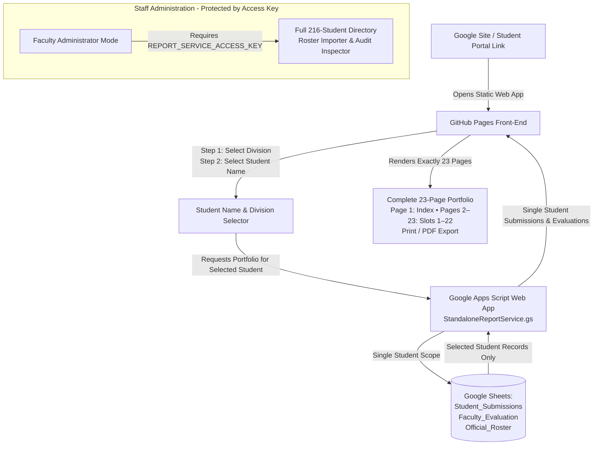

> Unlisted-student update: follow [the manual integration instructions](backend/UNLISTED_DEPLOYMENT.md). Deploy the shared identity policy and unchanged roster companion along with the server. Historical statements below about roster-only access or exactly 23 pages do not cover unlisted students or long-answer continuations. Publish only the explicit frontend allowlist; never publish this entire source directory or its existing ZIP.

# Standalone Student Assignment Report Generator — Controlled Deployment Guide

This guide details the controlled production deployment of the **Standalone Student Assignment Report Generator** via GitHub Pages and its integration into an institutional Google Site.

---

## 1. System Architecture & Distribution Model



### 1.1 Agreed Student Workflow
1. **Open Tool**: The student opens the application via a public button/link on our institutional Google Site.
2. **Select Division**: The student selects their division (`TE-A`, `TE-B`, or `TE-C`).
3. **Select Student Name**: The dropdown populates the official student roster for that division. The student selects their name from the list.
4. **Generate & Download**: The student clicks **Generate 23-Page Portfolio** and prints or saves their canonical 23-page report package.

There is **no mandatory Gmail sign-in, personal verification PIN, or credential entry**.

### 1.2 Access Behaviour & Privacy Notice (Important)
> [!IMPORTANT]
> **Open Access Workflow Notice:**
> The agreed name-selection workflow does **not authenticate the student**. Anyone with access to the published application (via the Google Site link or GitHub Pages URL) can select any student's name from the official roster and retrieve that student's portfolio.
> 
> Therefore:
> - The application **does not claim that portfolios are private** or that students can access only their own records.
> - The UI clearly identifies itself as an open student portfolio viewer and does not pretend that choosing a name verifies identity.
> - **Data Minimization:** Even though access is open, the backend service queries and returns **strictly the selected student's submissions and evaluations**. It never dumps bulk submission records or exposes unrelated administrative data to student requests.
> - **Administrative Protection:** Faculty administration, full submission datasets, Excel import tools, discrepancy audit inspectors, and spreadsheet configuration controls remain strictly separated and protected behind `REPORT_SERVICE_ACCESS_KEY`.
> - **Read-Only Spreadsheet Access:** Zero spreadsheet write operations (`appendRow`, `setValue`, `deleteRow`, `clear`) exist anywhere in the backend or frontend.

---

## 2. Access Specifications & Role Separation

| Attribute | Student Access Portal (Public Workflow) | Faculty Administrator Mode |
| :--- | :--- | :--- |
| **Default Access** | **Public Default** (Google Site / GitHub Pages) | Hidden / Protected behind passcode |
| **Workflow** | Select Division $\rightarrow$ Select Name $\rightarrow$ Generate | Enter `REPORT_SERVICE_ACCESS_KEY` |
| **Authentication Requirement** | **None** (No Gmail login, PIN, or password) | Constant-time access key verification |
| **Server Action** | `action: "getStudentReport"` | `action: "getReportData"`, `"getAllSubmissions"` |
| **Data Scope Returned** | **Strictly single selected student's records** | Complete multi-division submissions dataset |
| **Identity Resolution** | Roster matching (resolves TE-B duplicate rolls) | Full 216-student directory & reconciliation audit |
| **Spreadsheet Access** | Read-Only (Zero write methods) | Read-Only (Zero write methods) |
| **Workstation Storage** | None needed | Session / Local / Memory tier (cleared on purge) |

---

## 3. GitHub Pages Deployment Procedure

### 3.1 Front-End Assets Verification
The application files in `tools/standalone-student-report-generator/` are self-contained:
- Entry point: `index.html`
- Styles: `css/report-generator.css`
- Core modules:
  - `js/assignment-registry.js` (Canonical 22 assignment slots)
  - `js/official-roster.js` (Authoritative 216-student roster & duplicate handling)
  - `js/data-service.js` (Data management, student authentication, and storage tiers)
  - `js/report-renderer.js` (23-page HTML/print generator)
- Vendor libraries:
  - `js/vendor/xlsx.full.min.js` (Excel roster parsing)

All script and stylesheet references in `index.html` use relative paths:
```html
<link rel="stylesheet" href="css/report-generator.css">
<script src="js/vendor/xlsx.full.min.js"></script>
<script src="js/assignment-registry.js"></script>
<script src="js/official-roster.js"></script>
<script src="js/data-service.js"></script>
<script src="js/report-renderer.js"></script>
```
No `file:///`, `localhost`, or machine-specific drive paths are used.

### 3.2 Deployment Options on GitHub

#### Option A: Subdirectory in Existing GitHub Pages Repository
If your main repository already serves GitHub Pages from the root or `/docs`:
- The application will be accessible at:
  `https://<organization>.github.io/<repository>/tools/standalone-student-report-generator/`
- All relative paths will resolve correctly without URL rewriting.

#### Option B: Dedicated Repository or `gh-pages` Branch
1. Create a dedicated release branch or repository.
2. Copy the contents of `tools/standalone-student-report-generator/` into the root.
3. In repository settings: **Pages** > **Source**: `Deploy from a branch` > branch: `main` / `gh-pages` > folder: `/ (root)`.
4. URL will be:
  `https://<organization>.github.io/<repository>/`

---

## 4. Google Apps Script Backend Deployment

### 4.1 Create the Google Apps Script Project
1. Navigate to [script.google.com](https://script.google.com/) and create a new project named `DES_Standalone_Report_Service`.
2. Copy the complete code from [`tools/standalone-student-report-generator/backend/StandaloneReportService.gs`](file:///d:/DES241026/DesignEngineeringStudio-main/tools/standalone-student-report-generator/backend/StandaloneReportService.gs) into `Code.gs`.

### 4.2 Set Script Properties (Mandatory — Fail Closed)
1. Go to **Project Settings** (gear icon) > **Script Properties** > **Add script property**.
2. Configure:
   - `TARGET_SPREADSHEET_ID`: The Google Spreadsheet ID containing `Student_Submissions`, `Faculty_Evaluation`, and `Official_Roster` sheets.
   - `REPORT_SERVICE_ACCESS_KEY`: A cryptographically random secret string for faculty administration.
   - `ALLOWED_DOMAIN` (Optional for Google Sign-In): Institutional Google Workspace domain (e.g. `college.edu`).
3. Click **Save script properties**.

### 4.3 Publish as Web App
1. Click **Deploy** > **New deployment**.
2. Configuration:
   - **Type**: Web app
   - **Description**: `DES Standalone Student Report Service v2.1`
   - **Execute as**: `Me (your institutional Google account)`
   - **Who has access**: `Anyone` (or `Anyone with an account in <your organization>`).
3. Deploy and record the **Web app URL** (`https://script.google.com/macros/s/.../exec`).

---

## 5. Google Sites Linking and Embedding

### 5.1 Linking via Action Button (Recommended)
1. Open your Google Site in edit mode.
2. Under **Insert**, select **Button**.
3. Name: `View My DES Assignment Portfolio`.
4. Link: Your published GitHub Pages URL (e.g. `https://<org>.github.io/<repo>/tools/standalone-student-report-generator/`).
5. Place the button prominently in the Student Portal section.

### 5.2 Embedding via Iframe
1. Under **Insert**, select **Embed** > **By URL**.
2. Paste the GitHub Pages URL.
3. Adjust frame width to 100% and height to minimum `900px` for optimal viewing.

---

## 6. Pre-Flight Verification Checklist

- [x] All 71 regression tests in `test_report_generator.js` pass with 100% success.
- [x] All 25 configuration & security tests in `test_connection_and_configuration.js` pass with 100% success.
- [x] All 10 student access & authorization tests in `test_student_access_and_authorization.js` pass with 100% success.
- [x] Canonical 23-page requirement verified (Page 1 Index, Pages 2–23 the 22 Assignment Slots).
- [x] Read-only integrity verified: Zero write methods in backend and client code.
- [x] Zero hardcoded secrets in client-side code, HTML, or logs.
- [x] Dual-mode architecture implemented: Student Portal is public default; Faculty Mode is protected by passcode.
- [ ] **External Administrative Action Required**: Deploy `StandaloneReportService.gs` to live Apps Script and configure `TARGET_SPREADSHEET_ID` and `REPORT_SERVICE_ACCESS_KEY`.
- [ ] **External Administrative Action Required**: Publish GitHub Pages and add link to Google Site.
